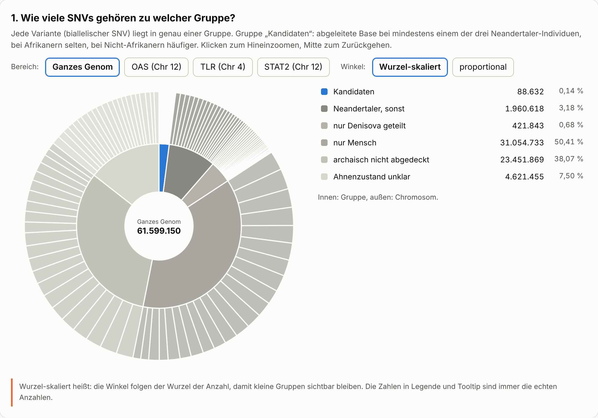
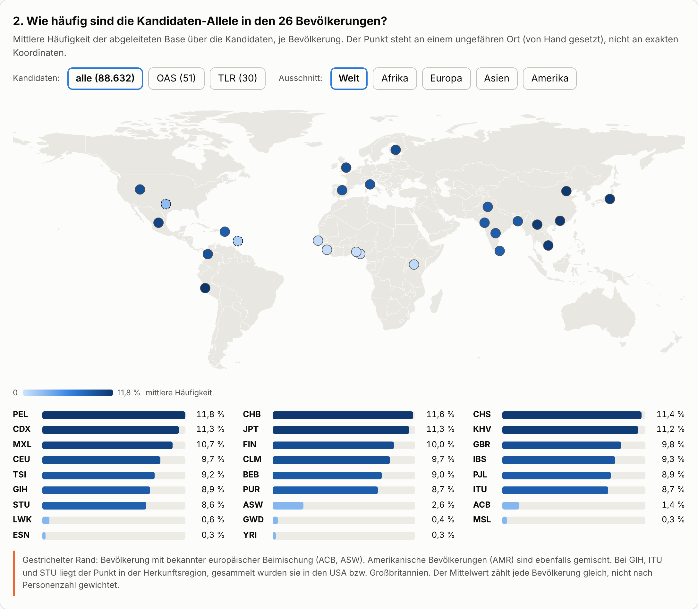
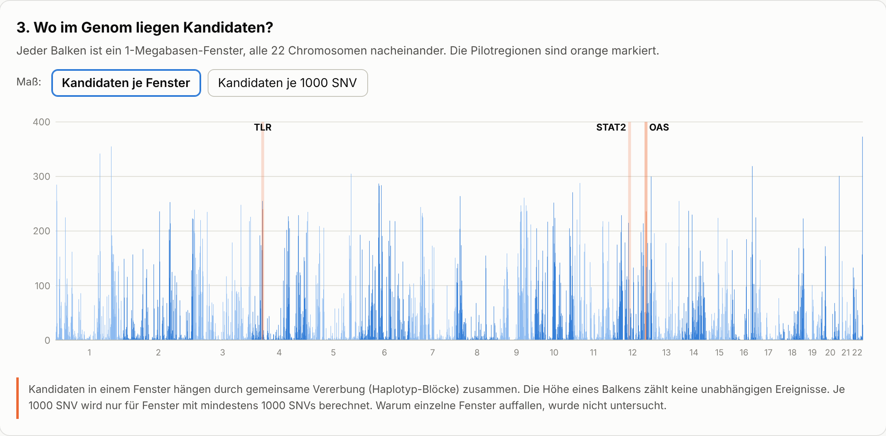
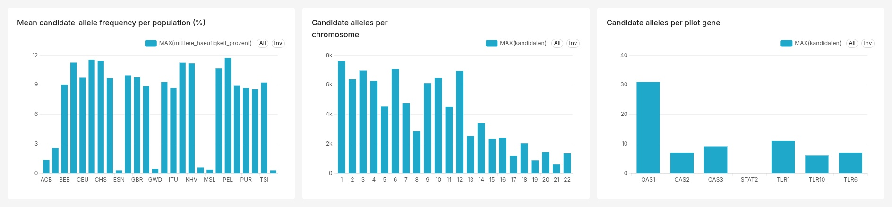
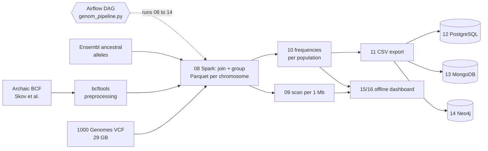

<p align="center">
  
</p>

<p align="center"><sub>Banner: portrait artwork generated with ChatGPT to my specification; the chart in the lower part was added with Claude from this project's own scan results.</sub></p>

# Project Human Evolution

[](https://github.com/HeikoHan72/human-evolution-pipeline/actions/workflows/ci.yml)


**Which of our DNA variants look like Neandertal inheritance?** A Spark pipeline over the full 1000 Genomes
data set (61.6 million SNVs, 3,202 people) that tests Neandertal candidate alleles in immune-gene regions
(OAS1/2/3, TLR1/6/10, STAT2) and scans all 22 autosomes. The results are loaded into PostgreSQL, MongoDB and
Neo4j and shown in an offline dashboard.

**[Live dashboard](https://HeikoHan72.github.io/human-evolution-pipeline/)** (German labels) ·
**[Full documentation (PDF, German)](docs/Projekt_Evolution_Dokumentation.pdf)** ·
**[Deutsche Kurzfassung](README.de.md)**

> Final project of the AI Engineer programme, module 5 "Big Data Engineering". Author: Heiko Han.
> Developed with AI assistance (Claude); the method, checks and decisions are documented in the PDF.

The results are **hints on candidate alleles in regions, not a genome-wide Neandertal share.**

## Results

| | |
|---|---|
| Biallelic SNVs analysed (GRCh38, chr 1-22) | 61,599,150 |
| Candidate alleles | 88,632 (0.14 %) |
| Candidates in the pilot regions | 81 (OAS 51 of 1,989 SNVs; TLR 30 of 2,391; STAT2 0 of 258) |
| People / populations | 3,202 / 26 (AFR 893, AMR 490, EAS 585, EUR 633, SAS 601) |
| Archaic genomes | 4 (Altai, Vindija, Chagyrskaya Neandertals; Denisova) |
| Candidates carried by all 3 Neandertals | 67,992 (76.7 %) |

- **Positive control works.** OAS1/2/3 on chromosome 12 is the best-documented Neandertal locus of the three
  pilot regions (Sams et al. 2016) and yields 51 candidates.
- **The pattern follows ancestry.** Mean derived-allele frequency over all candidates is 8.6 to 11.8 % in
  Europeans, East Asians, South Asians and Americans, but only 0.3 to 2.6 % in the African populations
  (the two highest, ASW and ACB, are admixed populations with known European ancestry).
- **Candidates are clustered, not independent.** Neighbouring candidates are inherited together (haplotype
  blocks), so a tall bar in the genome scan is not many independent events. Why individual windows stand out
  was not investigated.

<p align="center">
  
</p>
<p align="center">
  
</p>
<p align="center">
  
</p>

## Superset dashboard

Besides the offline dashboard, the PostgreSQL database `genom` (script 12) is connected to **Apache Superset 6.0.0**.
Three charts on the tables `haeufigkeiten`, `scan_1mb` and `kandidaten`: mean candidate-allele frequency per
population, candidates per chromosome, and candidates per pilot gene (STAT2 shows the negative result).
Setup, import of the exported dashboard and notes: [superset/README.md](superset/README.md).

<p align="center">
  
</p>

## Method in one paragraph

Every SNV of 1000 Genomes is joined with the **ancestral base** (Ensembl Ancestral Alleles, release 112) and
the genotypes of four archaic genomes. A variant becomes a **candidate** (group
`geteilt_Neandertaler_nicht_afrikanisch`) if

1. at least one of the three Neandertals carries the derived (non-ancestral) base, **and**
2. the derived base is rare in Africans (AFR frequency <= 3 %), **and**
3. it is more common in non-Africans (mean of AMR/EAS/EUR/SAS >= 5 %).

The derived base is a role per site, not a fixed letter. Condition 2 is part of the rule, so "rare in Africa"
is not independent evidence for archaic origin. The 3 % / 5 % thresholds are my own decisions.

## Architecture



| Step | Script | What it does |
|---|---|---|
| 01-07 | `src/01_*.py` ... `07_*.py` | Development and cross-checks on the pilot regions |
| 08 | `src/08_alle_chromosomen.py` | Spark: VCF + ancestral state + archaic genotypes, grouping, Parquet per chromosome; skips finished chromosomes |
| 09 | `src/09_scan_pro_megabase.py` | Candidates per 1 Mb window (Spark SQL, window function) |
| 10 | `src/10_kandidaten_populationen.py` | Derived-allele frequency per candidate and population (broadcast join, `posexplode`) |
| 11 | `src/11_export_fuer_datenbanken.py` | CSV export |
| 12 | `src/12_postgres_genom.py` | PostgreSQL: 6 tables, view, keys and indexes after bulk `COPY`, 5 queries |
| 13 | `src/13_mongodb_genom.py` | MongoDB: 88,632 documents with embedded frequencies, 4 aggregation pipelines |
| 14 | `src/14_neo4j_genom.py` | Neo4j: the 81 pilot candidates as a graph, 4 Cypher queries |
| 15-16 | `src/15_*.py`, `src/16_*.py` | Dashboard data and a single self-contained HTML file |
| DAG | `src/genom_pipeline.py` | Airflow DAG running 08 to 14 |

Shared code: `src/00_config.py` (paths, genes, regions), `genom_funktionen.py`, `genom_spark.py`, `genom_chrom.py`.
Script names and comments are in German (course language).

Spark runs locally (`local[4]`, 4 GB, 16 shuffle partitions).

## Quickstart

Requirements: Python 3.11, Java (OpenJDK 21), `bcftools`, and for steps 12-14 running PostgreSQL, MongoDB and Neo4j.

```bash
git clone https://github.com/HeikoHan72/human-evolution-pipeline.git && cd human-evolution-pipeline
python -m venv .venv && source .venv/bin/activate
pip install -r requirements.txt

cp .env.example .env          # fill in database passwords, never commit .env
```

**Raw data (about 80 GB) is not part of this repository.** Download it from the sources below into
`data/Datensätze/` (or point `GENOM_BASIS` in `.env` elsewhere). The expected layout and file names are set in
`src/00_config.py`. Then:

```bash
scripts/preprocess_archaic.sh                 # one-off: archaic BCF -> TSV
python src/08_alle_chromosomen.py             # hours on a laptop
python src/09_scan_pro_megabase.py
python src/10_kandidaten_populationen.py
python src/11_export_fuer_datenbanken.py
GENOM_NEU_AUFBAUEN=1 python src/12_postgres_genom.py   # rebuild only on explicit request
python src/13_mongodb_genom.py
python src/14_neo4j_genom.py
python src/15_dashboard_daten.py && python src/16_dashboard_bauen.py
```

Without the raw data you can still open the result files in `results/` and the dashboard in `docs/index.html`.

Tests and lint (no raw data needed):

```bash
pip install -r requirements-dev.txt
ruff check src && pytest
```

## Data sources

| Role | Data set | Licence |
|---|---|---|
| Present-day humans | 1000 Genomes, NYGC 30x, 3,202 people, phased VCF, GRCh38 | see source |
| Neandertals, Denisova | Skov et al., archaic variants (hg38), [Zenodo 13368126](https://zenodo.org/records/13368126) | CC BY 4.0 |
| Ancestral state | Ensembl Ancestral Alleles, release 112 | see source |
| Early human (pilot only) | Ust'-Ishim, VCF (hg19), lifted to hg38 | see source |
| Gene coordinates | NCBI GRCh38.p14 annotation | see source |

Exact download links are in the [documentation](docs/Projekt_Evolution_Dokumentation.pdf), section 2.
The licence terms of the sources other than Zenodo were not checked individually; no raw data is redistributed here.

## Limitations

Stated plainly, because they matter more than the headline numbers:

- **Candidates, not proof.** The rule finds variants that are consistent with Neandertal inheritance. It does not
  establish origin, and it says nothing about a genome-wide Neandertal percentage.
- **Two person sets.** The candidate rule uses the allele frequencies from the VCF INFO fields for the 2,504
  unrelated people. The per-population frequencies in step 10 (dashboard, databases) use the 2,590 founders
  (no parents in the data set) of all 3,202 people. A table row can therefore show an AFR value slightly above
  3 % although the rule says <= 3 %.
- **Literature checked for OAS only** (Sams et al. 2016, Genome Biology, DOI 10.1186/s13059-016-1098-6).
  Literature on TLR1/6/10 and STAT2 was not verified.
- **Pipeline testing.** The steps were run one by one. In the Airflow DAG only the Neo4j task was run end to end;
  the Spark tasks were not tested through the DAG, there was no complete rerun from an empty output folder, and no
  Airflow webserver/scheduler was set up.
- **Thresholds** (3 % / 5 %) are own decisions and were not tuned or validated.
- The gene list is defined three times (scripts 12, 13, 14).
- The quality of the archaic genotype calls was taken from the source as is.

## Roadmap

- [x] Apache Superset dashboard on the PostgreSQL database (`superset/`, three charts), in addition to the
      offline dashboard. Still open: more charts (candidate strength, genome scan per window).
- [ ] `docker-compose.yml` for the three databases.
- [ ] Run the Spark tasks end to end through the Airflow DAG.
- [ ] Define the gene list once and import it in 12-14.

## Repository layout

```
src/        pipeline scripts and shared modules
scripts/    one-off preprocessing (bcftools)
tests/      unit tests for the helper functions
results/    small result files (scan per 1 Mb, mean frequency per population)
docs/       GitHub Pages dashboard (index.html), images, documentation PDF
```

## References

- Sams et al. (2016), Adaptively introgressed Neandertal haplotype at the OAS locus functionally impacts innate
  immune responses in humans. *Genome Biology*. DOI 10.1186/s13059-016-1098-6
- Skov et al., Archaic variants from Altai, Vindija, Chagyrskaya and Denisova (hg38). Zenodo,
  DOI 10.5281/zenodo.13368126

## Licence

Code: [MIT](LICENSE). The data sets keep their own licences.
